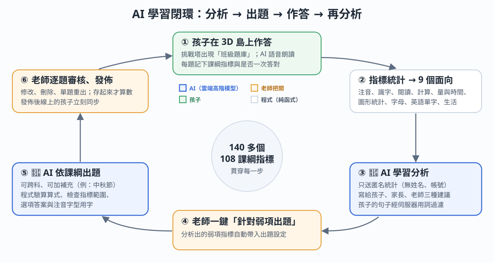
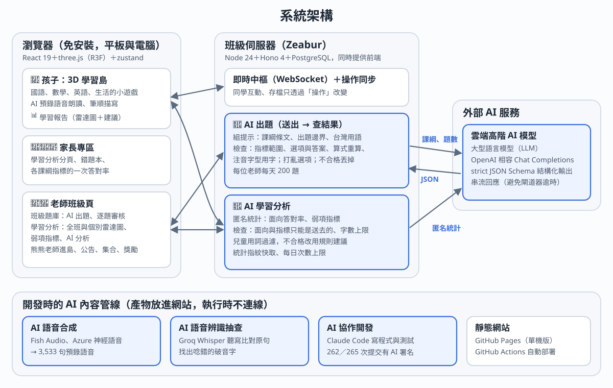

::: cover
# 知識島大冒險

[給國小二年級的 AI 適性學習島]{.sub}

[作品說明書｜財團法人亞太文經學術基金會 AI 創新服務與軟體應用研究獎勵活動｜創作者：{{AUTHOR}}｜115 年 10 月]{.meta}

| 網址（孩子免帳號就能玩；老師與 AI 功能用示範帳號） | 原始碼 |
| --- | --- |
| learning-island.zeabur.app | github.com/kevintsai1202/learning-game |

示範老師帳號與示範孩子的登入資料寫在報名信裡。
:::

## 一、問題或需求說明

國小二年級是識字與數感的關鍵期，但練習這件事卡在三個人身上：

- **孩子**還在學注音、認得的字不多，很多題目讀不懂，得有大人在旁邊唸；單調的練習也很難讓七歲的孩子主動坐下來。
- **老師**要依 108 課綱出題，班上每個孩子卡在不同地方。要找出「誰在哪個能力弱」，再為這些弱點另外出題，需要大量時間，通常只能等段考後才發現。
- **家長**只看得到分數，不知道孩子哪一項能力需要加強，也不知道在家怎麼陪練。

現有的題庫 App 多是固定題庫，老師沒辦法依自己班這週的進度與主題出題；通用的 AI 聊天機器人雖然能出題，但不對齊課綱、答案沒人驗算、用字不一定適合二年級，也沒有把作答結果接回下一次出題。

## 二、目標使用者

| 使用者 | 情境 | 作品提供的 |
| --- | --- | --- |
| 國小二年級的孩子 | 學校平板、家裡的平板或電腦 | 3D 島上的小遊戲、AI 語音朗讀題目、看得懂的學習報告與鼓勵 |
| 二年級老師 | 備課、課堂練習、補救教學 | AI 依課綱跨科出題並由程式把關、逐題審核發佈、全班與個別的學習分析、一鍵針對弱項出題 |
| 家長 | 晚上陪孩子練習 | 學習分析分頁：孩子的強項、要加強的地方、在家怎麼陪練 |

## 三、服務內容及使用情境

孩子操控小動物在低多邊形的 3D 小島上走動，走進建築就能玩各科的小遊戲：數學城堡（21 個技能 × 3 個難度）、文字森林（852 個國字的筆順描寫、注音、部首、造詞、閱讀）、ABC 海灘（字母描寫與單字）、生活村（交通安全、垃圾分類等），挑戰塔是段考模擬與老師的「班級題庫」。所有題目都標註 108 課綱指標，並對應康軒、南一、翰林三家教材版本。答題賺的金幣可以布置自己的家、和同學在班級島的遊樂園一起玩。

::: shots

:::

**情境一｜週一備課**：老師勾選數學「十十乘法」與生活「常見的食物」兩個指標，補充「主題：中秋節」，AI 約一分鐘出好 5 題草稿。程式標出要注意的地方，老師改一題、刪一題後發佈；班上的平板立刻同步，孩子在挑戰塔看到「班級題庫」。

**情境二｜放學回家**：孩子在島上按 📊，看到自己的雷達圖與 AI 寫的鼓勵和建議（按 🔊 就唸給他聽），按「去練習」直接走到對應的建築。家長在家長專區看到寫給大人的摘要與陪練方法。

**情境三｜補救教學**：老師打開全班的學習分析，看到「鐘面的時刻」是全班最弱的指標，按「🤖 AI 分析全班」得到文字分析，再按「針對這些指標 AI 出題」，弱項指標已經勾好，直接出補救題。

## 四、AI 技術使用方式

作品的 AI 分成「執行時的服務」與「開發時的內容管線」兩層。核心是執行時的兩項服務，兩者接成一個閉環。

{.fig}

### 4.1 老師 AI 出題（執行時）

1. 老師在班級頁勾選課綱指標（最多 10 個，可跨科）、題數、題型（單選、數字、排順序）、難度，可加補充說明（300 字內，例如「第三課生字：山、水、火」）。
2. 伺服器組提示：課綱條文原文、依課綱備註的出題邊界（例如乘式寫成「每份數量 × 份數」）、台灣正體字與用語、不抄教科書、避開敏感題材。補充說明當資料、不當指令。
3. 呼叫**雲端高階 AI 模型**（OpenAI 相容介面），用 **strict JSON Schema** 取得結構化的題目，串流接收、一次 5 題，畫面連續呼叫到老師要的題數。
4. **程式檢查**（純函式、有單元測試）：指標必須在老師選的範圍內；選項不重複、答案索引有效；數字題要求模型另給算式，伺服器重算並和答案比對；解說裡的算式算不出答案時標提醒；用到注音字型沒有的字標提醒；單選題的選項由伺服器打亂、排序題由伺服器拆成詞卡。不合格的題目丟掉並說明原因。
5. 草稿交給**老師逐題審核**：修改、刪除、單題重出，存起來才算數；發佈後班上線上的孩子立刻同步。

| 實測（正式環境） | 數值 |
| --- | --- |
| 一批 5 題 | 24～66 秒，跨科的兩個指標全部通過檢查 |
| 成本 | Contributor 方案每百萬 tokens US$0.10（輸入）／0.20（輸出），一批題目約新臺幣幾分錢（不到 1 角） |
| 額度 | 每位老師每天 200 題（請求前預扣、失敗退回） |

### 4.2 AI 學習分析（執行時）

孩子每答一題，系統記下題目的課綱指標與是否一次答對。140 多個指標依領域分成 9 個學習面向（注音、識字、閱讀、計算、量與時間、圖形統計、字母、英語單字、生活），算出每個面向的一次答對率，畫成雷達圖，並找出弱項指標。

- **送給 AI 的只有匿名統計**：各面向的答對率與作答數、弱項指標的代碼與條文、全班人數；不送名字、暱稱或帳號。
- **一次呼叫、三種讀者**：孩子的鼓勵與最多 3 個建議、家長的摘要與陪練建議；老師另有全班分析與單一孩子分析。
- **給孩子看的內容由伺服器把關**：AI 的提示只是提醒，過濾才是保證。建議不能有比較或貼標籤的字（比同學、落後、最差、笨…），每句最多 40 字，每個建議都要對到一個真的面向（「去練習」才有目的地）；過濾後一個都不剩就改用規則建議。
- **快取**：統計分桶後算指紋，沒有明顯變化就回上次的結果、不再呼叫 AI；每個孩子每天最多 5 次、每位老師 30 次。
- **分析接出題**：老師按「針對這些指標 AI 出題」，分析出的弱項指標自動帶進 4.1 的出題設定，形成閉環。

### 4.3 開發時的 AI 內容管線

- **AI 語音**：二年級孩子還不太識字，題目與介面都要能唸出來。3,533 句固定句子（介面、生活、英語、37 個注音符號）用 AI 語音合成預錄（Fish Audio、Azure 神經語音），不受平板內建語音品質的限制；破音字用讀音標記修正。
- **AI 語音辨識抽查**：預錄語音送 Whisper 聽寫，和原句比對，自動列出可能唸錯的句子給人複聽。
- **AI 協作開發**：整個系統用 Claude Code 開發，2026-10-01 起 265 次提交中 262 次由 AI 共同撰寫；AI 寫的程式由約 1,300 個單元測試案例與 58 支 e2e 測試把關。

### 4.4 如果拿掉 AI

| 功能 | 沒有 AI 時 | 說明 |
| --- | --- | --- |
| 依課綱出題 | 老師只能手動逐題輸入 | AI 讓老師一分鐘拿到對齊課綱、驗算過的草稿，這是服務的核心 |
| 全班與個別的學習分析 | 只剩數字與雷達圖，沒有文字分析與建議 | 老師要自己讀 9 個面向 × 全班的數字 |
| 分析接出題的閉環 | 斷掉 | 弱項指標要老師自己抄、自己出題 |
| 孩子的學習報告 | 改用固定句子的規則建議 | **刻意設計的安全後備**：給七歲孩子的畫面不能因為 AI 服務中斷而空白 |
| 朗讀 | 退回平板內建語音 | iPad 的內建中文語音品質差，識字少的孩子很難自己玩 |

## 五、系統或服務流程

{.fig}

1. 孩子在瀏覽器開網址就能玩（免安裝）；單機版的進度存在裝置上，加入班級後透過「操作」同步到班級伺服器，伺服器用同一份規則套用，避免竄改。
2. 班級島用 WebSocket 即時同步：同學的位置、老師的公告與集合、班級題庫的更新。
3. AI 工作採「送出 → 查結果」：伺服器收到請求後先回工作編號，背景呼叫雲端模型、檢查、存結果，畫面輪詢；避免長請求經過閘道器逾時。
4. 所有 AI 產出都經過伺服器的程式檢查後才給人看：出題給老師審核，分析經用詞過濾後給孩子。
5. 前端推到 GitHub 後自動部署到 GitHub Pages 與 Zeabur；伺服器使用 PostgreSQL（測試用 PGlite）。

::: {.shots .four}

:::

## 六、創新性及與既有服務之差異

| 比較 | 一般題庫 App | 通用 AI 聊天機器人出題 | 知識島大冒險 |
| --- | --- | --- | --- |
| 題目來源 | 固定題庫 | 臨時對話產生 | 內建題庫＋老師依課綱指標用 AI 出題 |
| 課綱對齊 | 依單元 | 不一定 | 每題標 108 課綱指標，AI 只能出老師勾選的範圍 |
| 正確性 | 人工編寫 | 沒有驗算 | 程式重算算式、檢查答案與用字，再由老師審核 |
| 學習分析 | 分數 | 無 | 9 個面向的雷達圖＋給孩子、家長、老師的 AI 建議 |
| 分析與出題 | 分開 | 無 | 一鍵把弱項指標帶進 AI 出題，形成閉環 |
| 兒童安全 | — | 輸出不可控 | 只送匿名統計；給孩子的句子由伺服器過濾，不合格用規則後備 |
| 識字前的孩子 | 多要大人唸 | 不適用 | 3,533 句 AI 語音，注音字型直接標在國字旁 |
| 學習動機 | 題目與分數 | 文字對話 | 3D 島、布置自己的家、班級遊樂園、和同學互訪 |

## 七、實際完成程度

| 項目 | 現況 |
| --- | --- |
| 上線 | learning-island.zeabur.app 可直接使用（另有 GitHub Pages 單機版）；10/13 上線老師 AI 出題（12:26）與 AI 學習分析（19:05），並在正式站用真的雲端模型跑過驗收腳本 |
| 內容 | 國語、數學、英語、生活 4 科；140 多個課綱指標；852 個國字的台灣教育部筆順；三家教材版本 |
| 班級功能 | 老師建班、QR code 加入、學校平板教室密碼、熊熊老師進島公告與集合、獎勵、班級題庫 |
| 測試 | 約 1,300 個單元測試案例（出題、判題、AI 回應檢查都是純函式）；58 支 e2e、多台裝置同時連線；AI 功能另有正式環境驗收腳本 |
| 開發 | 2026-10-01 開始，265 次提交；伺服器沒設 AI 金鑰時自動隱藏 AI 功能，其他功能照常 |
| 隱私 | 隱私權政策寫明送給 AI 的資料（課綱設定、匿名學習統計）與雲端 AI 服務的使用方式 |

## 八、未來發展及應用價值

- **擴到其他年級**：課綱指標、面向對照與 AI 提示都是資料驅動，換一份指標表就能延伸到一到六年級。
- **更多 AI 題型**：撥時鐘、付錢、描寫題目前不給 AI 出；下一步讓 AI 出這些互動題型，並加入題目來源開關與班級版本包。
- **語音辨識**：用語音辨識評量孩子的朗讀與注音拼讀，補上「說」的能力。
- **老師社群**：審核過的班級題庫可以分享給其他班，累積經過老師把關的 AI 題目。
- **應用價值**：免費、免安裝、平板瀏覽器就能用，適合資源少的小校與偏鄉；AI 只拿匿名統計，學校導入的隱私門檻低；每批題目的 AI 成本不到新臺幣 1 角，可以長期營運。

::: appendix
## 附錄　第三方 AI 模型、API、開源程式、資料集與素材

依辦法第五條 4(5) 與第八條揭露。作品免費提供、沒有廣告、不收費，屬非商業使用。

| 類別 | 名稱 | 用途 | 來源與授權 |
| --- | --- | --- | --- |
| AI 模型（執行時） | Meta Muse `muse-spark-1.3-contributor` | 老師 AI 出題、AI 學習分析 | api.meta.ai；Meta 的 API 條款。Contributor 方案：Meta 可用送出的內容（課綱設定、匿名學習統計）訓練模型，隱私權政策已揭露；改 Standard 方案只要換模型名稱 |
| AI 語音合成 | Fish Audio「詩涵 Shihan」「承翰 Chenghan」（Fish Official 公開聲音），模型 s2.1-pro-free | 預錄語音（介面、生活、英語）、遊樂園的喊聲、本作品的展示影片旁白 | fish.audio；免費方案（條款限個人、非商業使用） |
| AI 語音合成 | Fish Audio 帳號內創作者自建的聲音模型「凱文大叔」，模型 s2.1-pro-free | 展示影片的另一個旁白版本 | fish.audio；免費方案 |
| AI 語音合成 | Microsoft Azure AI Speech「曉臻 zh-TW-HsiaoChenNeural」 | 37 個注音符號 | Azure F0 免費方案 |
| AI 語音辨識 | Groq `whisper-large-v3-turbo`（OpenAI Whisper，MIT） | 預錄語音的聽寫抽查（開發時） | groq.com 免費額度 |
| AI 開發工具 | Anthropic Claude Code | 撰寫程式與測試（開發時） | Anthropic 服務條款 |
| 課綱 | 十二年國民基本教育課程綱要 | 出題依據、指標條文 | 國教署公開的課綱文件；題目自行編寫 |
| 教材版本資料 | 教育部教育百科「生字詞彙表」 | 三家版本的課名、生字、語詞 | 政府網站公開資訊（只取事實資料），非開放授權 |
| 開放資料 | CNS11643 中文標準交換碼全字庫 | 注音、部首、筆畫、台灣筆順序列 | 政府資料開放授權條款第 1 版 |
| 筆順字形 | animCJK、Make Me a Hanzi | 國字筆順描寫（只採台灣筆順驗證通過的字） | Arphic Public License |
| 字型 | 注音粉圓 BpmfHuninn（子集「LG Bopomofo Round」） | 國字旁的注音 | SIL OFL 1.1 |
| 開源程式 | React、three.js／React Three Fiber／drei、zustand、zod、Hanzi Writer、Vite、Hono、PGlite | 前端、3D、伺服器 | MIT（PGlite 為 Apache-2.0／PostgreSQL License） |
| 音樂 | Cozy Puzzle 系列（MintoDog）、Buy Something!（Cleyton Kauffman） | 遊戲與影片配樂 | OpenGameArt，CC0 |
| 音效 | Freesound.org 標為 CC0 的錄音 | 班級島大型設施 | CC0；逐檔來源見 public/audio/sfx/rides/CREDITS.md |
| 生活題的事實依據 | 衛福部、疾管署、消防署、交通部、環境部公開資訊 | 洗手、餐盤、防災、交通安全、垃圾分類 | 政府公開資訊；題目文字自編 |
| 3D 模型與圖像 | — | 島上所有模型 | 全部以程式用基本幾何體建立，沒有外部模型或圖片 |

完整清單在遊戲的「家長專區 → 資料來源」與原始碼 `src/content/sources.ts`，授權全文在 `public/licenses/`。
:::
